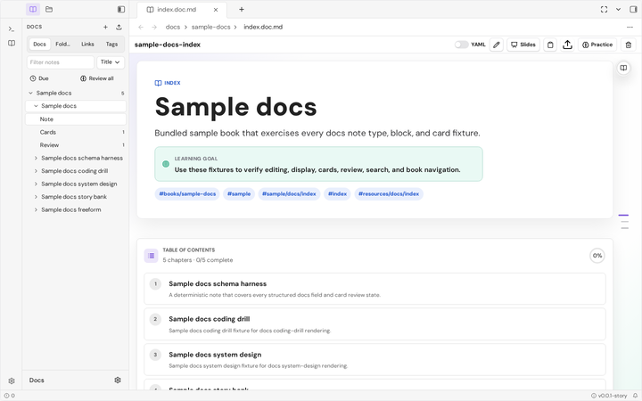
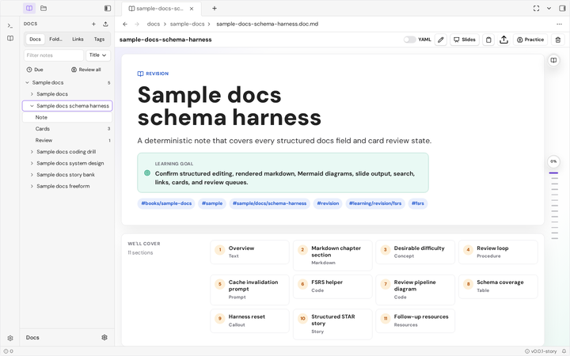
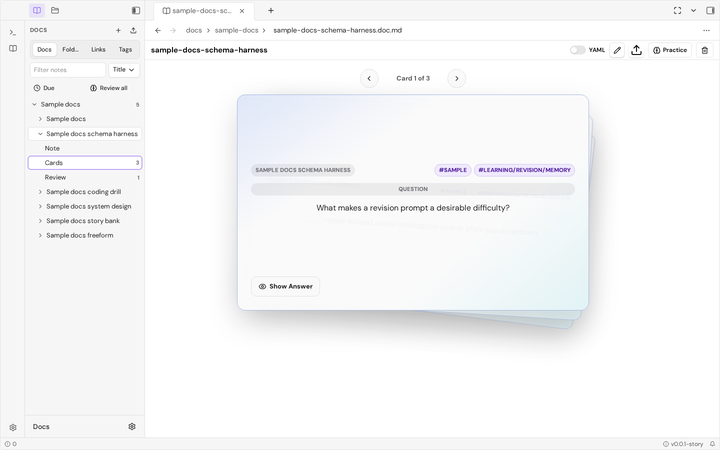

# `@lapis-notes/lapis-plugin-docs`

[](https://github.com/lapismd/lapis-plugin-docs/actions/workflows/ci.yml)
[](https://github.com/lapismd/lapis-plugin-docs/actions/workflows/publish-storybook-pages.yml)
[](https://lapismd.github.io/lapis-plugin-docs/)

First-party external Docs plugin for Lapis. It provides vault-native
`*.doc.md` notes, ordered books, linked knowledge, cards, and FSRS review
through public Lapis and Design Core surfaces inside the host workspace.

The plugin owns the Docs domain model, document view, sidebar, cards, review,
settings, and native `--ui-docs-*` styling. Hosts own plugin loading, vault
state, persistence, and application policy.

[](registry-assets/banner.full.png)

<details>
<summary>Plugin screenshots</summary>

[](registry-assets/gallery/reading.full.png)

[](registry-assets/gallery/cards.full.png)

</details>

## Current package status

- Package version: `@lapis-notes/lapis-plugin-docs@0.2.0`.
- Runtime plugin id: `docs`.
- Runtime peers: `@lapis-notes/api@^0.2.6`,
  `@lapismd/design-core@^0.12.1`, `@lapismd/mira@~0.1.4`,
  `@lapismd/mira-editor@~0.0.3`, and `svelte@5.56.10`.
- Canonical repository: `lapismd/lapis-plugin-docs`.
- Live catalog: <https://lapismd.github.io/lapis-plugin-docs/>.
- Canonical requirements live in `spec/src/plugins/docs/`; verification
  status is tracked in `spec/src/verification.md`.

## Install

Hosts load the plugin class through the Lapis plugin lifecycle. `onload`
registers the Docs projection, document and sidebar views, commands, ribbon,
and settings.

```sh
pnpm add @lapis-notes/lapis-plugin-docs
```

Import the plugin stylesheet once at the application boundary:

```ts
import "@lapis-notes/lapis-plugin-docs/styles.css";
```

## Runtime surfaces

| Surface | Entry | Use for |
| --- | --- | --- |
| Docs document | `*.doc.md` exclusive editor-view contribution | Structured editing, reading, slides, cards, and note-scoped review |
| Docs sidebar | Movable `docs` workspace view | Browse notes, folders, links, tags, due cards, and review queues |
| Projection | `docs/note` | Index Docs metadata and content from the configured vault root |
| Cards | Basic and cloze card panels | Create cards, inspect references, and manage scheduling metadata |
| Review | FSRS-backed note and workspace queues | Study due cards and persist review outcomes to the source note |
| Import | Lazy Anki package reader | Import supported `.apkg` collections and media into the vault |
| Settings | Versioned plugin data | Configure the Docs root, which defaults to `docs` |

## Document and review coverage

Docs files are ordinary Markdown with YAML front matter. The filesystem is
authoritative: books order their chapters, wiki links and tags form a graph,
and review state travels with each card in its source document. Structured
reading uses the host `MarkdownRenderer` when available and public Mira
preview as the fallback.

The bundled sample book exercises structured blocks, Mermaid diagrams,
slides, links, tags, basic and cloze cards, due queues, and FSRS history. The
same deterministic fixtures power the package Storybook and the committed
README screenshots.

## Styling contract

The plugin uses native CSS, Design Core semantic tokens, and Docs-owned
`docs-` classes with `--ui-docs-*` custom properties. Production sources stay
free of Tailwind utility strings (`pnpm check:no-tailwind`).

1. Import `@lapis-notes/lapis-plugin-docs/styles.css` once.
2. Theme through Design Core tokens and Docs custom properties.
3. Keep package-owned surfaces independent of host-private selectors.

## Layout conventions

```text
src/
  lib/            plugin class, views, repository, domain model, native CSS
  stories/        App-backed shell, placement, and registry capture stories
fixtures/
  sample-docs/    deterministic *.doc.md Storybook corpus
spec/
  src/            canonical specification and verification evidence
```

## Usage example

A Docs document is Markdown with structured front matter:

```markdown
---
id: spaced-repetition
title: Spaced repetition
docType: revision
tags:
  - learning/memory
cards:
  - id: retrieval-practice
    type: basic
    status: active
    prompt: Why use retrieval practice?
    answer: Recalling an idea strengthens access to it.
---

# Spaced repetition

Review material shortly before it would otherwise be forgotten.
```

## Storybook and local documentation

Run the local catalog (defaults to port 7040):

```sh
pnpm storybook
pnpm storybook:stop
pnpm storybook:restart
```

Build the static catalog:

```sh
pnpm build-storybook
```

`Plugins/Docs/Registry Screenshots` contains the deterministic workspace,
reading, and cards states used to refresh the committed README media. These
capture stories are intentionally separate from visual-regression baselines.

The canonical specification lives in `spec/src`. Validate it after protected
source, story, or presentation changes:

```sh
pnpm exec spec-validator search "Storybook"
pnpm spec:check
```

### CI and local parity

CI runs specification, quality, unit, package, static Storybook, and sharded
Storybook interaction lanes on every pull request and push to `main`. The
static catalog is published to GitHub Pages from `main`.

`pnpm test:storybook` runs the Storybook Vitest project with Playwright.
Interaction and accessibility behaviour stays executable in the capture
stories; screenshot files are generated from their completed states.

## Release and validation

Common validation commands:

```sh
pnpm spec:first
pnpm spec:check
pnpm check
pnpm test
pnpm build
pnpm publint
pnpm test:storybook
pnpm build-storybook
```

## Further reading

| Resource | Use |
| --- | --- |
| [`spec/src/plugins/docs/index.md`](./spec/src/plugins/docs/index.md) | Canonical plugin ownership and package requirements |
| [`spec/src/plugins/docs/runtime.md`](./spec/src/plugins/docs/runtime.md) | Runtime, sidebar, Storybook, and import behaviour |
| [`spec/src/plugins/docs/notes.md`](./spec/src/plugins/docs/notes.md) | Document model and reading behaviour |
| [`spec/src/plugins/docs/cards.md`](./spec/src/plugins/docs/cards.md) | Cards and review behaviour |
| [`spec/src/spec-governance.md`](./spec/src/spec-governance.md) | Governance, validation, and discovery rules |
| [`spec/src/verification.md`](./spec/src/verification.md) | Requirement verification evidence |
| [`AGENTS.md`](./AGENTS.md) | Contributor and agent workflow |
| [`PROVENANCE.md`](./PROVENANCE.md) | Component provenance and exclusions |
